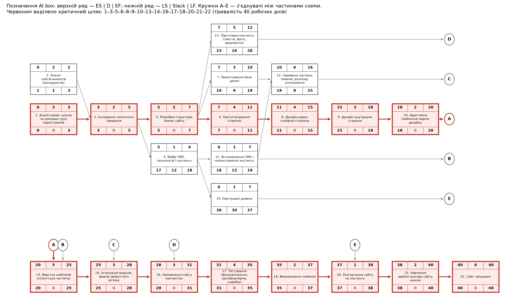
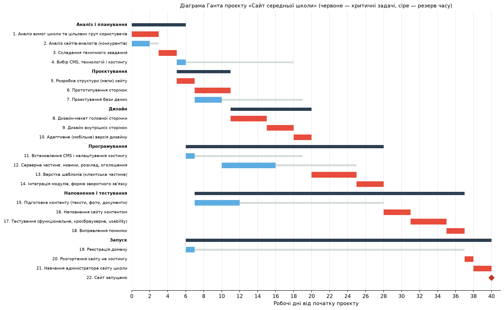

# ПЗ-1. План проєкту за методом CPM
22 задачі, тривалість 40 робочих днів, після оптимізації – 35 днів. Дані розрахунку – [../cpm.json](../cpm.json).

Звіт (docx) подано викладачу окремо; у репозиторії – лише матеріали без особистих даних.
